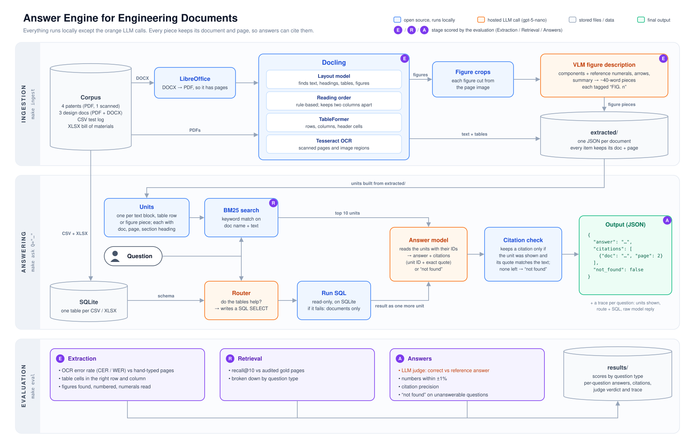

# Answer Engine for Engineering Documents

**macOS only.** This code and these instructions were built and tested on macOS 15 (Apple Silicon). They have not been tested on Linux or Windows.

## Architecture



## Setup and commands

### 1. System packages (install once, with [Homebrew](https://brew.sh))

```bash
brew install uv tesseract
brew install --cask libreoffice
```

- **uv** installs Python 3.12 and the pinned Python packages.
- **Tesseract 5** is the OCR engine.
- **LibreOffice** converts the DOCX to PDF so it has page numbers.
- **make** comes with the Xcode command-line tools (run `xcode-select --install` if it is missing).

### 2. Python packages

The versions are pinned in two files:
- `pyproject.toml` lists the 12 packages the code imports, with exact versions, and requires Python 3.12.
- `uv.lock` lists all 134 packages they pull in, with exact versions and file hashes. `requirements.txt` holds the same versions in pip's format, exported from the lock (`uv export --frozen --format requirements-txt --no-hashes -o requirements.txt`).

**With uv (recommended):** nothing to do. Every `make` command runs `uv run --frozen`, which creates `.venv/` and installs exactly what `uv.lock` lists on first use. To install up front, run `make setup` (`uv sync --frozen`).

**With pip instead:**

```bash
python3.12 -m venv .venv
source .venv/bin/activate
pip install -r requirements.txt
```

then run the commands without `make`:

```bash
python -m answer_engine.ingest
python -m answer_engine.ask "What is the IP rating of the EV-BMS-100?"
python -m answer_engine.ask --questions questions.json --out answers.json
python -m answer_engine.evaluate                    # dev set
python -m answer_engine.evaluate questions.json     # another questions file
```

The first `ingest` downloads Docling's layout and table models from Hugging Face.

### 3. Configuration

**Set your API key:**

```bash
export OPENAI_API_KEY=sk-...
```

**Corpus:** put the exercise folder (`patents/`, `design_docs/`, `structured/`, `dev_set/`) in the repo as `swe-coding-exercise/`.

**Optional settings** (in the shell, or in a `.env` file in the repo; `.env.example` lists them):
- `ANSWER_MODEL` / `FIGURE_MODEL` change the models (default `gpt-5-nano`).
- `OPENAI_BASE_URL` points to another OpenAI-compatible endpoint.
- `CORPUS_DIR` points to the exercise folder if it's somewhere else.

### 4. Commands

| Command | What it does |
|---|---|
| `make ingest` | Extracts every PDF / DOCX in the corpus and describes its figures → `extracted/` |
| `make ask Q="What is the IP rating of the EV-BMS-100?"` | One answer, as JSON in the brief's shape |
| `make answer QUESTIONS=questions.json OUT=answers.json` | Answers for a whole questions file (`[{"id", "question"}]`), e.g. a hidden test set |
| `make eval` | Extraction, retrieval and answer scores on the dev set → `results/` |
| `make eval QUESTIONS=questions.json` | The same scores on another questions file in the dev set's format (`id`, `type`, `question`, `reference_answer`, `evidence`) |

## Dev-set gold page corrections

Page-level scores (recall@k, citation precision) are reported against an **audited** copy of the dev set's evidence pages. Four questions were checked against the source pages. Two dev-set pages are wrong, and two leave out a second page that also holds the answer.

| q | Question (short) | Dev set says | Audited | Where the answer actually is |
|---|---|---|---|---|
| q02 | What reduces the transfer head's traverse rate before the stopping point? (US2,988,237) | p2 | **p1** | Scanned patent. Only page 1 mentions the function control anticipator 64: "…cooperate with a function control anticipator 64 so that fast traverse of the transfer head is reduced in advance of the required stopping point…" (right column, plus the FIG. 2 description and claims 1–2). Page 2 has only the end of claim 3 and claim 4. |
| q07 | Ingress protection rating of the EV-BMS-100 enclosure | p3 | **p2** | "Ingress protection \| IP67 \| connectors mated" is a row of the mechanical spec table on page 2. Page 3 has no IP67. |
| q05 | What recharges the UAV's battery, and what is the mechanism called? (US2017/0320570A1) | p2 | **p1, p2** | Page 2, claim 3: "wireless power transfer (WPT) circuitry 40 configured to inductively recharge the onboard power source…". Page 1, body text: "The battery or batteries 38 may be inductively recharged via wireless power transfer (WPT) circuitry 40 while the UAV is in a tail-sitting position on a recharging pad." |
| q16 | How many M12 connector ports are shown in Figure 2 of the EV-BMS-100 design document? | p3 | **p2, p3** | The figure itself, showing the four ports and labelled "M12 connector x4", is on page 2. Its caption ("…showing the four M12 connector ports…") is on page 3. |

## Failure analysis

Failures found on the dev set while building the system. Each one was traced through the steps: the units shown to the model, the route, and the model's raw reply.

| q | Question | What went wrong | Stage | What we did |
|---|---|---|---|---|
| q01 | In US8,485,576 B2 (Robotic Gripper), what provides the attractive force at the tip of pin 120 in the electromagnetic embodiment? | Answered "not found". BM25 needs exact words, and four things worked against the right unit: (1) the question says "electromagnetic", the claim says "electromagnet" (no stemming); (2) "attractive force" is the wording of the neighbouring suction claim, so it lifts the wrong units; (3) the patent number written with commas tokenizes to `us8`, which matches nothing, while its digits lift short metadata units; (4) the answer sits in a long unit (several claims merged into one list item), which BM25 scores down. At k=5 the right unit ranked 6th. At k=10 it was retrieved, but the exact quote check dropped the citation ("the distal end" vs "a distal end"). | Retrieval, then the citation check | Prompt asks for quotes copied word for word; k 5 → 10 (still failed); then quotes checked by fuzzy matching (≥ 0.9 similarity). Now correct, citing p2. |
| q15 | In FIG. 3 of US2017/0320570A1, what is component 18? | "Not found" in every run. The figure's numerals were lost in extraction: Tesseract read the label words but only "8", "8" and "4" of the nine numerals (12, 14, 16, 18, 20, 28, 34, 38, 46). The numerals touch the box outlines, and Tesseract treats a numeral joined to a line as part of the drawing. | Extraction (figure OCR) | Erasing the box lines before OCR read all 9, but it failed where an arrow runs through a numeral (74 and 76 in the scanned patent's FIG. 2). So a VLM now describes each figure (components with their numerals, arrows). One long description per figure ranked too low in BM25, so the VLM also splits its description into ~40-word pieces, each a search unit starting with the figure number. Now correct. |
| q05 | What recharges the UAV's battery in US2017/0320570A1, and what is the mechanism called? | The answer was right, but the model attached the same quote to two units: the paragraph that holds it, and an empty heading from the same patent ("CLAIMS: What is claimed is:") that was listed first. That second citation was made up. BM25 had filled 4 of the top 5 with that same heading from four patents: the question's "what" (×2) and "is" match these 4-word units strongly. | Generation (citation), with noisy retrieval | Added the citation check: a citation is kept only if it points to a unit the model was shown and its quote is found in that unit's text. The heading was dropped; the output cites only UAV p1. |
| q20 | What is the extended cost of the FVT-ESC-40A line item in the bill of materials? | SQL returned the right value and the model answered with it bare, "180.0" (no "$", no 8 × $22.50). The LLM judge marked it incorrect; in a later run the same answer was marked correct. | Generation (answer form) and evaluation (judge) | Not fixed. |

## Known limitations

**Search needs the question's exact words.** BM25 matches whole words, with no stemming or synonyms, so when the question's words differ from the extracted text, the right unit scores low or not at all. Examples from this corpus:
- word forms and synonyms: "electromagnetic" vs "electromagnet" (q01), "component 18" vs "device 18" (q15);
- OCR misreads on the scanned patent: "transter" for "transfer";
- identifiers written differently: "US8,485,576" in the question vs "US 8,485,576" in the patent.

## Future work

1. **Figure descriptions with function, not just geometry.** Today the VLM mostly describes what is drawn: shapes, positions and arrows (e.g. "Left thrust device 18 is a rectangular block located below the left wing"). Asking it for what each component does would let figure units answer questions about function.
2. **Hybrid search.** Keep BM25 for exact terms (part numbers, numerals, spec names), and for harder queries, or when BM25 leads to "not found", hand off to (or mix in) similarity search over LLM embeddings, so questions whose words differ from the text still reach the right units.
